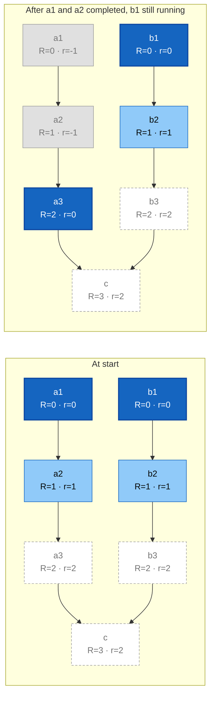

# Orchestration :lucide-wand-sparkles:

Sirocco workflows can be orchestrated by two engines. A **standalone** one running autonomously on the HPC cluster and an **[AiiDA :lucide-external-link:](https://aiida.net/)** based one, still under development, which runs on a dedicated server.

## The deep propagating task front

On HPC systems, every job waits in a queue before it runs. A workflow manager that submits a task only once its parents have completed makes each link of a dependency chain pay that waiting time again, and the scheduler only ever sees a small part of the upcoming workload. Submitting the whole workflow at once is no better: it can amount to thousands of jobs, all of which would need to be cancelled if something goes wrong.

Climate and weather workflows are deterministic: the full graph is known before the first task runs. Sirocco takes advantage of this by submitting a bounded number of task generations _ahead of time_, chained by scheduler dependencies, and by moving this window forward as tasks complete. This window is the **task front**. In short, it is a **deep**, **propagating** set of **dynamical topological generations**. To explain these terms, we consider the [directed acyclic graph (DAG) :lucide-external-link:](https://en.wikipedia.org/wiki/Directed_acyclic_graph) made of task nodes only, removing data nodes from the [full workflow graph](configuration/cycles.md#cycles). Edges between nodes thus become task dependencies, either derived from input/output relationships or from explicit [`wait_on`](configuration/cycles.md#wait_on) dependencies.

- [**topological generations** :lucide-external-link:](https://networkx.org/documentation/stable/reference/algorithms/generated/networkx.algorithms.dag.topological_generations.html) partition a DAG into sequential levels, the so-called "generations", based on their dependency depth. Nodes in generation 0 have no parents, parents of nodes in generation 1 are only from generation 0 and, more generally, parents of a node in generation $R$ are only from generations $<R$. We call $R$ the _global rank_. It is fixed once and for all by the structure of the graph.
- **dynamical generations** are the same partition, computed on the graph of tasks that are _not yet completed_. Each task gets a _local rank_ $r$: completed tasks have $r = -1$ and any other task has $r = 1 + \max(r_\text{parents})$, so that $r = 0$ when all its parents have completed. Rank 0 tasks therefore have all their dependencies satisfied and are either running or waiting in the queue, while tasks with $r \geq 1$ are already submitted but held by scheduler dependencies on their parents.
- **deep front**. Only tasks with $r < d$ are submitted, where $d$ is the front depth set with [`front_depth`](configuration/configuration.md#front_depth). A depth of 1 disables ahead-of-time submission, a depth of 2 submits one generation ahead, and so on. Larger depths give the scheduler more information at the cost of more queued jobs, which all need to be cancelled when stopping the workflow. Tasks beyond the front are marked with $r = d$.
- **propagating front**. Whenever rank 0 tasks complete, local ranks are updated following the definition above. Since parents can be spread over any lower generations, only the highest one matters: a task in generation $k$ moves down to $k - 1$ only once _none_ of its parents is left in generation $k - 1$, _i.e._ once all of them are in generation $k - 2$ or below (completed tasks included). In the same way, a task enters the front at $r = d - 1$ only once all its parents are in generation $d - 2$ or below. At first, the front coincides with the first $d$ global generations. As soon as a branch of the DAG advances faster than others, the front gets distorted: a dynamical generation then contains tasks with different global ranks $R$, higher on the fast branch and lower on the others.

The figure below illustrates this distortion on a small workflow made of two independent branches joined by a final task `c`, with a front depth $d = 2$.


<figcaption markdown="span" style="text-align: left; font-style: normal; font-size: smaller;">
*Propagation of a task front of depth $d = 2$.* Dark blue: rank 0 tasks (running or queued). Light blue: rank 1 tasks (submitted ahead of time). Dashed: tasks beyond the front ($r = d$, not submitted). Grey: completed tasks ($r = -1$). Once branch `a` has progressed, generation 0 of the front contains `a3` ($R = 2$) and `b1` ($R = 0$).
</figcaption>

## Standalone engine

The standalone engine enables Sirocco workflows to run autonomously on the HPC cluster, relying on the scheduler as the sole running daemon. The [task front](#the-deep-propagating-task-front) described above is thus not propagated by a permanently running process but by a dedicated job, the **Sirocco continuation task**. It is submitted with a scheduler dependency on the termination of _any_ rank 0 task, so that the scheduler starts it as soon as one of them terminates, successfully or not. Between two continuation tasks, the workflow state, _i.e._ the front generations and the completed tasks, is stored in the `run/state.yaml` file. The continuation task is configured via the [special `SIROCCO` task](configuration/tasks.md#the-special-sirocco-task) and, as other Sirocco [controling processes](../usage/standalone/#controlling), logs its activity to `sirocco.log` in the configuration directory.

### Front propagation

When the workflow is [started](usage/standalone.md#start), Sirocco

1. builds the initial front: tasks without parents form generation 0 and each following generation $r = 1, \dots, d - 1$ gathers the tasks whose highest-ranked parent is in generation $r - 1$,
2. submits all front tasks, each with a scheduler dependency on the successful completion of all its parents, so that the scheduler holds tasks with $r \geq 1$ until their parents have successfully completed,
3. submits the continuation task,
4. and finally dumps the workflow state to file.

Each time the continuation task kicks in, it

1. loads the workflow state,
2. queries the scheduler for the status of rank 0 tasks and propagates the front following the rules [above](#the-deep-propagating-task-front): completed tasks leave the front, the other ones move down when all their parents allow it and newly eligible tasks are submitted to generation $d - 1$,
3. submits the next continuation task,
4. and finally dumps the workflow state to file.

This loop ends in one of the two following ways:

- **failure**: if a rank 0 task has failed, the continuation task cancels all tasks of the front, marks the workflow as failed and does not submit a new continuation task.
- **completion**: once all tasks have completed, the front is empty, the workflow is marked as completed and no new continuation task is submitted.

The workflow can also be [stopped](usage/standalone.md#stop) and [restarted](usage/standalone.md#restart) from the command line.

### Workflow folder hierarchy

The standalone engine executes workflows in place, _inside their [configuration directory](glossary.md#configuration-directory)_. Starting the execution, Sirocco creates a `run` directory in the configuration directory and each task will run inside its own run directory at `run/task_rundir_name`, where `task_rundir_name` is a unique name looking like this:
```shell
<task_name>__<coordinate1_name>_<coordinate1_value>__<coordinate2_name>_<coordinate2_value>__[...]
```
[Coordinates](glossary.md#coordinates) of a task are either its date, in which case `<coordinatex_name>` is `"date"` and `<coordinatex_value>` is the date formatted as `"YYYY-MM-DDThh-mm-ss"` or a [parameter](configuration/parameters.md), in which case `"<coordinatex_name>"` and `<coordinatex_value>` are the parameters name and value.

### `bash` shebang and base environment

Sirocco tasks are all submitted as _bash tasks_ with the `#!/bin/bash -l` shebang. Their base environment, i.e. before any modification by the task itself, is exactly the same as from a fresh `bash` login (for instance through `ssh`). This means that environment variables set after login to the interactive session will be ignored. Any environment variable relevant for workflow tasks must be explicitly specified at adequate places in the configuration.
